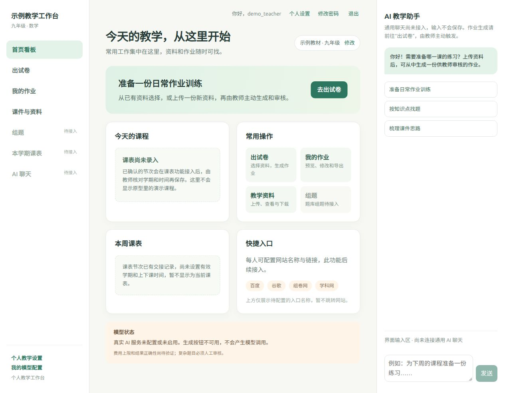
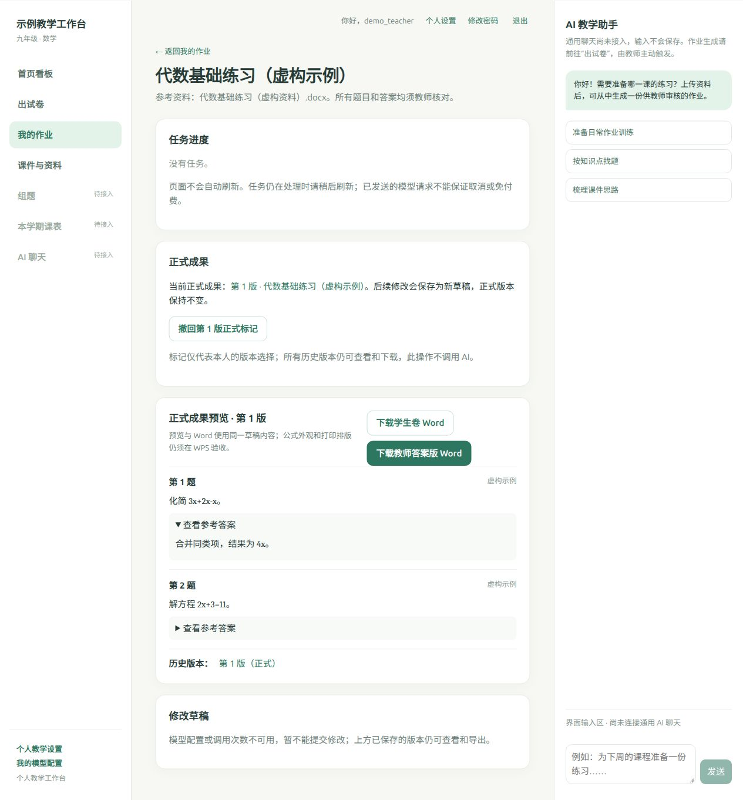

# 教师AI工作平台搭建

面向教师的个人教学工作台，支持上传 DOCX/PDF 资料、预览与管理作业版本，以及导出学生卷和教师答案版 Word。

## Docker 部署

在安装了 Docker 和 Compose 的电脑上新建一个目录，将下方完整配置保存为 `compose.deploy.yaml`。也可以下载 [compose.deploy.yaml](compose.deploy.yaml)。镜像支持 `linux/amd64`，可免登录拉取。新实例从空库开始，AI 默认关闭。[Docker Hub 镜像](https://hub.docker.com/r/huahua777/teacher-workbench)

```yaml
name: teacher-workbench
services:
  workbench:
    image: ${WORKBENCH_IMAGE:-huahua777/teacher-workbench:2026.11.06}
    restart: unless-stopped
    ports:
      - "${TW_BIND:-127.0.0.1}:${TW_PORT:-8000}:8000"
    environment:
      TW_ALLOWED_HOSTS: ${TW_ALLOWED_HOSTS:-localhost,127.0.0.1}
      TW_TRUSTED_ORIGINS: ${TW_TRUSTED_ORIGINS:-}
      TW_HTTPS: ${TW_HTTPS:-0}
      TW_TRUST_PROXY: ${TW_TRUST_PROXY:-0}
      TW_ENABLE_MEMBER_AI: ${TW_ENABLE_MEMBER_AI:-0}
      TW_APPLY_MIGRATIONS: ${TW_APPLY_MIGRATIONS:-0}
    volumes:
      - workbench_data:/var/lib/teacher-workbench
      - workbench_keyring:/var/lib/teacher-workbench-keyring
    stop_grace_period: 4m
    shm_size: 128mb
volumes:
  workbench_data:
  workbench_keyring:
```

在该文件所在目录执行下面两条命令。第一条等待服务健康，第二条按提示创建管理员账号和密码。

```sh
docker compose -f compose.deploy.yaml up -d --wait
docker compose -f compose.deploy.yaml exec workbench python manage.py createsuperuser
```

创建管理员后，在部署电脑打开 [http://localhost:8000/](http://localhost:8000/) 登录。两个命名卷分别保存业务数据与加密密钥。备份或搬迁时应成对保留。[数据、备份与升级](docs/docker-deployment.md#数据备份和升级)

## 界面预览

以下截图取自发布镜像 `2026.11.06` 的独立演示实例，账号、教材和作业均为虚构示例。

**工作台首页**展示出试卷、我的作业和教学资料入口。



**作业预览**展示正式成果、参考答案和两种 Word 下载。



## 详细部署说明

| 部署方式 | 适用场景 |
| --- | --- |
| [Compose 拉取镜像](docs/docker-deployment.md#docker-compose) | 首次安装，或用一份配置管理容器和数据卷 |
| [docker run](docs/docker-deployment.md#docker-run) | 直接从终端启动，无需 Compose 文件 |
| [从源码构建](docs/docker-deployment.md#从源码构建) | 开发者运行自己的修改 |
| [启用成员 AI](docs/docker-deployment.md#启用成员-ai) | 配置模型服务、成员调用次数与有效期 |
| [远程访问与 HTTPS](docs/docker-deployment.md#远程访问与-https) | 让其他设备通过受信任的 HTTPS 入口访问 |
| [备份、升级与回退](docs/docker-deployment.md#数据备份和升级) | 配对保管业务数据与密钥，迁移或更新实例 |
| [部署检查与排查](docs/docker-deployment.md#部署检查与排查) | 核对健康状态、处理端口占用或查看启动日志 |
| [EasyTier 私网与预发布](docs/docker-deployment.md#已有私网服务与测试环境) | 查找家中现有服务、预发布和测试栈的运维入口 |

## 状态说明

- **已确认需求**：首个验收场景为人教版九年级数学，任教 19、20 班，常用 WPS 和希沃白板；个人首页名称为“华华的教学工作台”。电脑横版优先，手机支持聊天、拍照上传、查看资料和课表、下载文件。
- **现场已验证**：Ubuntu 257 的五服务、EasyTier HTTPS、真实教师账号、一次成功作业及教师卷内容/WPS 显示/公式编辑；新配对快照、NAS 数据往返和同机独立新卷恢复。具体证据见[发布记录](docs/release-2026-10-29.md)和[当前状态](docs/status.md)。
- **当前功能**：成员登录与管理、个人资料、成员自己的加密模型配置、额度、主动生成作业、草稿预览及双 Word 导出。AI 请求由教师主动触发，厂商费用以账单为准。
- **待完成**：实际纸张打印、其他教师设备/学校网络、PWA、共享资料、完整题库与课表、通用聊天、教案/PPTX/希沃及空白异机恢复等。早期[域名正式配置草案](docs/production-readiness.md)未运行。
- 已认可的首页参考已导入 [设计参考目录](design-reference/README.md)。本地页面已采用相应浅绿三栏布局；电脑端导航获用户认可，手机宽度由本机浏览器检查，真实手机仍待验收。

## 已验收的最小流程与当前目标

上线流程：教师登录 → 上传含可提取文字的 DOCX/PDF → 自行选择模型配置和主动生成 → 查看草稿 → 下载学生卷与教师答案版 Word → 在 WPS 审核。用户已确认当前教师答案内容、显示和公式编辑正常；复杂数学题继续由教师审核，打印效果尚待现场检查。

## 使用已有的私网工作台

家中现有的 [EasyTier 私网限定使用版](docs/release-2026-10-29.md) 沿用独立试点栈中的教师账号和数据。

1. 使用者先连接 EasyTier，在自己的设备上信任项目 CA，再打开 [私网入口](https://10.0.30.5:18443/)；不要忽略浏览器证书警告。
2. 查看 [当前状态](docs/status.md)、[发布范围](docs/release-2026-10-29.md)和 [完整需求](docs/requirements.md)，区分已上线功能与后续目标。
3. 运维和回退依据见 [运行手册](docs/runbook.md)，后续功能见 [阶段路线图](docs/roadmap.md)。本项目已获授权使用 [GitHub 私有仓库](https://github.com/huahuaya777/teacher-workbench) 保存代码与文档；业务数据和密钥独立保存。当前推送状态见[当前状态](docs/status.md)。

跨设备接续开发请先读 [Ubuntu 开发机迁移说明](docs/migration-ubuntu-dev-2026-10-30.md)。

项目工作规则见 [AGENTS.md](AGENTS.md)。持续记录包括 [决定](docs/decisions.md)、[后续需求](docs/backlog.md)、[操作手册](docs/runbook.md) 和 [验收记录](docs/acceptance.md)。业务数据和密钥不进入 Git；详见该文件及 [.gitignore](.gitignore)。

交接包中的教学样本位于 `teacher-workbench-handoff/samples/`，仅供获准的本地开发验证，不能提交 Git、加入 Docker 镜像或默认共享给其他教师。
